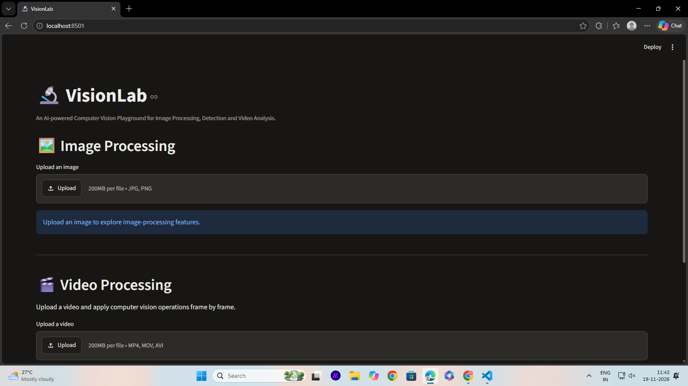
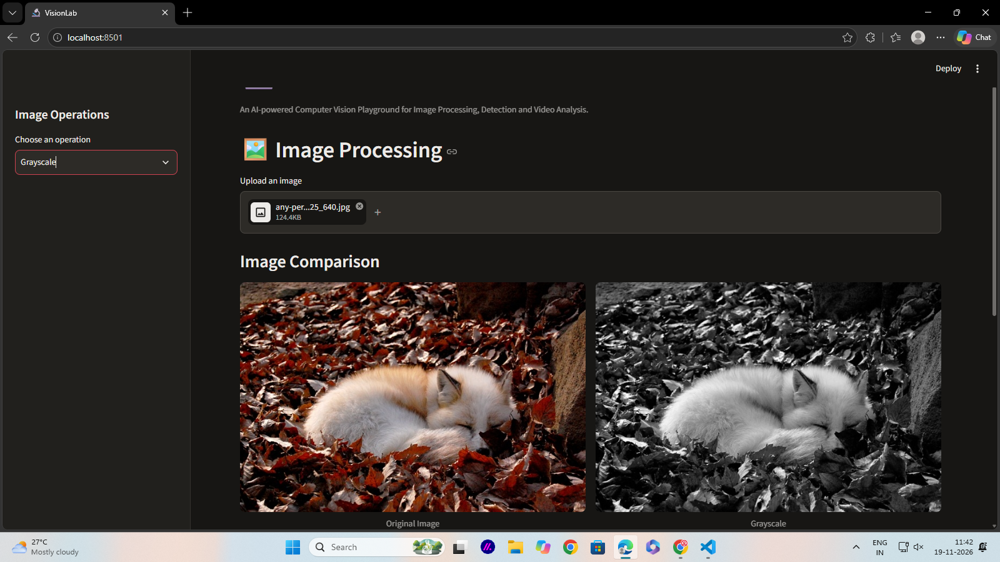
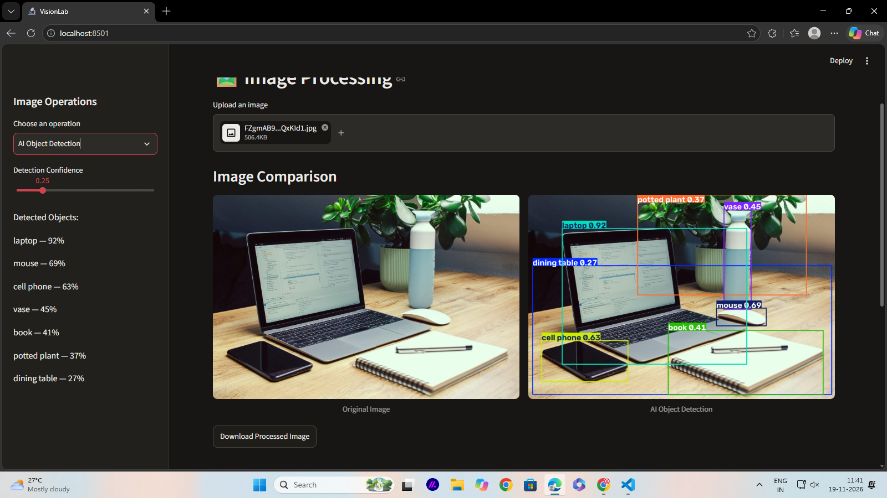
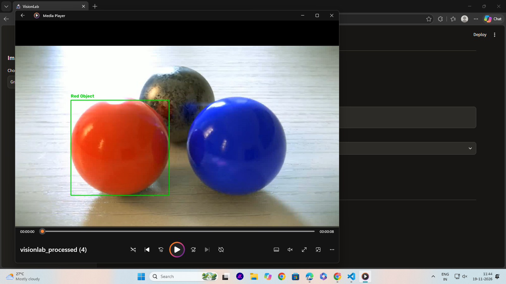

# VisionLab — Computer Vision Playground

**An interactive computer vision application for image processing, visual analysis, video processing, and AI-powered object detection.**

VisionLab is a Python-based computer vision project that brings together traditional image processing techniques and deep-learning-based object detection in one interactive application.

Built with OpenCV, NumPy, Streamlit, and YOLOv8, it allows users to upload images and videos, experiment with different computer vision operations, visualize results, and download processed outputs.

---

## Overview

Computer vision enables machines to extract meaningful information from visual data. VisionLab explores this through practical implementations of image enhancement, edge and contour detection, geometric shape recognition, color extraction, video processing, and object detection.

The application provides an accessible interface for experimenting with these techniques through an interactive web application.

## Features

### 1. Image Processing
- Grayscale conversion
- Gaussian blur and median blur
- Image sharpening
- Brightness and contrast adjustment
- Image thresholding
- Image resizing

### 2. Computer Vision Techniques
- Canny edge detection
- Contour detection and visualization
- Geometric shape classification
- HSV-based color detection and extraction

### 3. Video Processing
- Grayscale video conversion
- Video edge detection
- Gaussian blur
- Red-object tracking with bounding boxes and motion trails

### 4. AI-Powered Object Detection
- YOLOv8 pretrained object detection
- Adjustable confidence threshold
- Bounding-box visualization
- Object labels and confidence scores

### 5. Interactive Application
- Streamlit-based user interface
- Image and video uploads
- Original and processed image comparison
- Downloadable processed images and videos

---

## Application Preview

### Home Interface


### Image Processing


### AI Object Detection


### Video Processing


---

## Technology Stack

| Technology | Purpose |
|---|---|
| Python | Core programming language |
| OpenCV | Image and video processing |
| NumPy | Numerical and array operations |
| Streamlit | Interactive web application |
| Ultralytics YOLOv8 | Deep-learning object detection |
| Pillow | Image handling |
| Pytest | Automated testing |

---

## Project Structure

```text
visionlab/
│
├── app.py
├── README.md
├── requirements.txt
├── .gitignore
│
├── modules/
│   ├── image_processing.py
│   ├── edge_detection.py
│   ├── contour_detection.py
│   ├── shape_detection.py
│   ├── color_detection.py
│   ├── video_processing.py
│   └── object_detection.py
│
├── utils/
│   └── image_utils.py
│
├── assets/
│   └── sample_images/
│       ├── everyday_objects.jpg
│       ├── red_object.jpg
│       └── shapes.jpg
│
├── tests/
│   ├── test_processing.py
│   ├── test_video_processing.py
│   └── test_object_detection.py
│
├── screenshots/
│   ├── home.png
│   ├── image_processing.png
│   ├── object_detection.png
│   └── video_processing.png
│
└── docs/
    ├── architecture.md
    └── implementation.md
```

---

## Installation and Setup

### Prerequisites
- Python 3.10 or later
- Git
- Internet connection for installing dependencies and downloading pretrained YOLO weights when required

### 1. Clone the Repository

```bash
git clone https://github.com/harivenkatesh18-vbd/visionlab.git
cd visionlab
```

### 2. Create a Virtual Environment

**Windows**
```bash
python -m venv .venv
.venv\Scripts\activate
```

**macOS / Linux**
```bash
python -m venv .venv
source .venv/bin/activate
```

### 3. Install Dependencies

```bash
pip install -r requirements.txt
```

### 4. Run the Application

```bash
streamlit run app.py
```

The application will open in your browser.

---

## Usage

1. Launch VisionLab using Streamlit.
2. Upload an image or video.
3. Select the desired processing technique from the sidebar.
4. Adjust available processing parameters.
5. View the original and processed results.
6. Download the processed output where supported.

Sample images are available in `assets/sample_images/` for experimentation.

---

## Testing

VisionLab uses Pytest for automated testing.

Run the test suite:

```bash
python -m pytest tests -v
```

**Latest verified test result: 19 passed.**

The tests cover image processing, edge and contour detection, shape detection, color extraction, video processing, and object detection validation.

---

## Current Limitations

- YOLOv8 detection accuracy depends on image quality, object visibility, and the classes supported by its pretrained model.
- Red-object tracking is designed specifically for red-colored objects.
- Shape classification works best with clearly defined geometric shapes.
- Processing performance depends on the available hardware and input resolution.

## Future Improvements

- Custom-trained object detection models
- More advanced object tracking
- Additional image enhancement algorithms
- Expanded computer vision capabilities
- Improved performance and user experience

---

## Author

**Hari Venkatesh Gandha**

B.Tech Computer Science and Engineering Student

Interested in Artificial Intelligence, Computer Vision, Robotics, and building practical technology solutions.

- GitHub: [@harivenkatesh18-vbd](https://github.com/harivenkatesh18-vbd)
- LinkedIn: [Connect with me on LinkedIn](https://www.linkedin.com/in/hari-venkatesh-gandha-610b3340b/)

---

*Built as a hands-on exploration of computer vision, image processing, and AI-powered visual intelligence.*